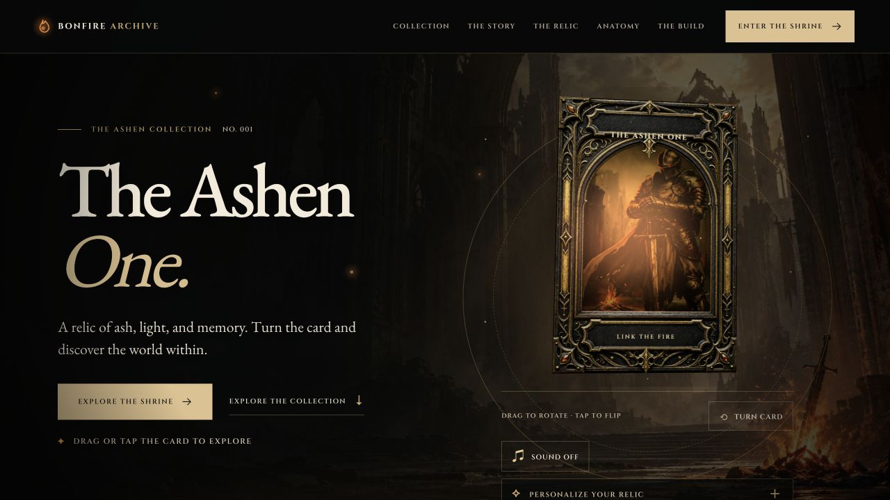

<div align="center">

# BONFIRE ARCHIVE

### A digital relic, brought to life in the light of the last ember.

An interactive Dark Fantasy showcase built with React, TypeScript, Three.js and GLSL.
Explore two relics, turn a holographic card, and uncover the story behind the scene.

**[✦ Explore the live experience](https://bonfire-archive-ashen-one.indigofern4096.chatgpt.site/)** &nbsp; · &nbsp; [Project walkthrough](#a-quick-tour) &nbsp; · &nbsp; [Run locally](#run-locally) &nbsp; · &nbsp; [Source and credits](#source-and-credits)

</div>

[](https://bonfire-archive-ashen-one.indigofern4096.chatgpt.site/)

<p align="center"><em>Turn the relic. Follow the embers. Discover what remains.</em></p>

---

## The experience

Bonfire Archive is an unofficial fan-inspired web programming project, designed as a small interactive museum. A custom Three.js hero introduces the Ashen One; the original ThreeUI scenes open when a visitor chooses a relic.

| Stop | What you can do |
| :--- | :--- |
| **The hero** | Drag or tap the 3D card, turn it over, change its light, and optionally enable ambient sound. |
| **The collection** | Choose The Ashen One or Cindermane and enter the corresponding interactive shrine. |
| **The chronicle** | Explore three illustrated chapters, either by selecting a chapter or scrolling through the story. |
| **The shrine** | Explore the original ThreeUI scene and reveal field notes about the Ashen One shrine. |
| **The workbench** | Select details, zoom, flip the card, compare both faces, and reset the view. |
| **Behind the build** | Explore the layers and shader that make the hero card feel dimensional. |
| **The last ember** | Kindle the closing bonfire and return to the shrine or source code. |

## A quick tour

1. **Start with the card.** Drag to rotate it or use **Turn card**, then try the lighting controls under **Personalize your relic**.
2. **Choose a relic.** Open either variant from the collection. In the shrine, drag to turn the card and use the on-screen instructions to explore.
3. **Look closer.** Select a point in the Workbench, zoom into a detail, or compare the front and reverse.
4. **See how it works.** Open the shader in **Behind the Build** and compare the custom hero with the original ThreeUI scene.

The interface adapts to smaller screens, includes keyboard controls and reduced-motion support, and keeps sound off until a visitor enables it. A static preview is available when WebGL is unavailable. These provisions have not been verified as a complete accessibility audit.

## Technology

| Layer | Built with |
| :--- | :--- |
| Interface | React 19, TypeScript, CSS |
| Custom hero | Three.js r180, layered textures, GLSL shader |
| Original shrine | Registered ThreeUI component and its HTML scene sources |
| Build | Vite |
| Hosting | OpenAI Sites; static build in `dist/` |

The custom hero and the original shrine are separate implementations. The hero pauses its render loop when off-screen or in a hidden tab; the shrine mounts on demand and is unmounted when off-screen or hidden. Decorative artwork animations also pause outside the viewport. The Workbench comparison uses layered 2D artwork.

## Run locally

**Requirements:** Node.js `^20.19.0` or `>=22.12.0` and npm. The 3D shrine requires WebGL and an internet connection for its original external resources.

```bash
git clone https://github.com/Chalermsak1/bonfire-archive-ashen-one.git
cd bonfire-archive-ashen-one
npm ci
npm run dev
```

Open the local address printed by Vite, typically `http://127.0.0.1:5173/`.

```bash
npm run build     # Type-check and create the production build in dist/
npm run preview   # Serve the built site locally
```

Vite currently emits a warning about `fragment-mono.woff2` referenced by the preserved shared ThreeUI CSS. The build succeeds; the referenced font is not included in this project.

## Project map

```text
src/
  Scene.tsx                 Page, navigation, story and interactive controls
  HeroRelic3D.tsx           Custom Three.js hero and GLSL
  app.css                   Archive layout, visual design and motion
  shaders/                  Registered ThreeUI component and shared CSS
public/
  archive/                  Artwork and fonts used by the archive shell
  landing-pages/            Original ThreeUI scene documents
  entrance.css              Opening loader styles
```

## Source and credits

The shrine uses the registered [ThreeUI Dark Souls Holo Card](https://threeui.com/hero/dark-souls-holo-card) source by Meng To / Design+Code. The surrounding archive, custom hero, story, and Workbench are built as the presentation for this project. Dark Souls names and imagery belong to their respective owners. This is an independent fan showcase, not an official product. See [CREDITS.md](CREDITS.md).

The published `@designcodeio/threeui@1.2.0` package does not export this component. The Vite and TypeScript aliases resolve the requested import to the registered local source. The Ashen One HTML embeds its artwork, models and fonts but loads Three.js modules from jsDelivr. Cindermane also loads original assets from Supabase. An internet connection is therefore required for the original scenes.

<details>
<summary><strong>Verified ThreeUI source hashes</strong></summary>

The four registered files are preserved byte for byte:

| File | SHA-256 |
| :--- | :--- |
| `src/shaders/dark-souls-holo-card/DarkSoulsHoloCard.tsx` | `8ec70d08f25b0e10d62afa3fe4cc68415acf67607041307a8e53c34153b997a5` |
| `public/landing-pages/dark-souls-holo-card.html` | `4373734e87a17720a853e4e6d36df174e0db59d668de2607f5dc9fb5927b109d` |
| `public/landing-pages/dark-souls-holo-card-cindermane.html` | `a34740e8810600de8e4c15bb96a4b14e177ab8735a84163521c90095403cb150` |
| `src/shaders/threeui.css` | `efe4447139f1358dd8e9be68edf6fa46cbefbd1de423a4d6c439ca61d2c8eccf` |

```bash
shasum -a 256 src/shaders/dark-souls-holo-card/DarkSoulsHoloCard.tsx \
  public/landing-pages/dark-souls-holo-card.html \
  public/landing-pages/dark-souls-holo-card-cindermane.html \
  src/shaders/threeui.css
```

</details>
